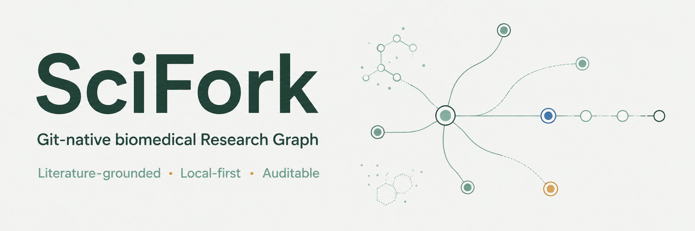

# SciFork

[](https://github.com/zhang-bin-98/sci-fork/actions/workflows/release.yml) [](https://github.com/topics/dsh-plugin) [](LICENSE)



[English](README.md) | [简体中文](README.zh-CN.md)

> 拆分假设，连接证据，推进研究。

SciFork 是面向 [DeepSeek Harness (DSH)](https://github.com/deepseek-ai/deepseek-harness) 的生物医学**研究图谱**插件。DSH Chat 始终是唯一的对话界面，SciFork 则在右侧栏提供可视化的研究图谱，把对话与文献检索中获得的信息沉淀为结构化、可追溯的科研知识。

> **当前版本：** SciFork `0.0.4` 适配 DSH `0.2.1-rc.2`（桌面端与同版本 Web）。

## 你可以做什么

- **深度研究**——在对话中直接提出深度研究请求，SciFork 会围绕研究目标开展多轮递进探索：每一轮自动检索文献、提炼初审证据、保留所有合格的候选分支，并自动挑选最具潜力的一条假设继续向下深挖，直至覆盖你的研究范围。
- **一键单步扩展**——在图谱中选中任意节点，点击 **Research & Expand**，即可基于当前节点向外有依据地推演一步（每次最多生成五条直接相连的候选分支）。
- **严格的证据门槛**——每条文献证据都绑定 PMID 或 DOI、原文位置与审核说明。模型自动提炼的初审证据可用于启发探索，但只有经过你人工确认的文献证据（或团队已验证的实验结果），才能支撑一条假设晋升为确立的**研究发现（Finding）**。
- **双视图浏览**——在 **Main** 视图全局把握研究脉络，或在 **Evidence** 视图聚焦单个节点的直接文献依据；通过 **Details** 面板阅读完整正文与分组引文。
- **纯本地文件 + Git**——整个项目保存在本地普通的 Markdown 与 JSON 文件中，每次修改自动在当前分支生成 Git 记录，方便你随时关联 GitHub 等远端仓库进行备份与协作。

## 视图与研究模型

- **Main 视图（默认）**——展示完整的研究结构：以开放式的**研究问题（Question）**为起点，连接候选的**假设（Hypothesis）**、可检验的**预测（Prediction）**、团队记录的**研究结果（Result）**以及已确立的**研究发现（Finding）**，清晰呈现各项主张之间的支持、反驳、因果与预测关系。
- **Evidence 视图**——当选中的节点包含直接文献依据时即可进入。该视图仅展示当前节点及其直接引用的**文献证据（Evidence）**，方便逐条核对原文依据；切回 **Main** 视图时会自动回到原节点。
- **Details 面板**——展示所选节点的完整正文、关联文献与审核计数，并按“人工已审核”“机器初审”“已拒绝”及“仅检索参考”分组列出引文来源。点击面板顶部的节点 ID 即可一键复制，便于在对话中精准指定操作对象。

## 安装与文献检索

**从插件面板安装（推荐）**：在 DSH 侧栏打开 **插件**，点击 **添加插件**，输入 `zhang-bin-98/sci-fork` 并安装（如提示构建脚本请选择允许），完成后点击 **立即启用**。若安装失败并提示 `ERR_PNPM_GIT_DEP_PREPARE_NOT_ALLOWED`，把错误信息中的精确 `allowBuilds` key 写入 profile 的 `pnpm-workspace.yaml` 后再点 **重试**。

**在会话中安装**：直接对模型说——“帮我安装 DSH 插件 `zhang-bin-98/sci-fork`”。

卸载时在插件页面选择 **移除** 即可，已创建的本地研究项目文件仍可正常阅读。

### 搭配文献检索

SciFork 自身不绑定特定文献库，会自动利用对话中的真实文献材料（按以下顺序适配）：

1. **检索插件（推荐）**——推荐同时安装 [`dsh-pubmed`](https://github.com/aiyacharley/dsh-pubmed)（已测试 `0.4.4` 版本）或其他文献/PDF 插件，让模型自动完成论文检索与摘要读取。
2. **联网搜索**——未安装检索插件或检索结果不足时，自动使用 DSH 内置的网页搜索获取文献信息。
3. **手动提供原文**——你也可以直接在对话中粘贴论文摘要或 PDF 段落（需附带有效的 PMID 或 DOI）。

无论通过哪种方式，只有具备有效 PMID/DOI 且包含真实摘要或原文段落的内容才会被采纳；仅有标题的记录会被自动跳过，绝不凭空编造引文。

## 快速开始

请选择一个空目录或独立的 Git 仓库根目录（不要放在其他 Git 仓库的子目录中，并确保本地 Git 已配置用户名和邮箱）。在 DSH Chat 中初始化当前目录：

```text
/research init
```

初始化完成后，从右侧栏引导卡片或左侧栏底部的 **Research Graph** 按钮打开图谱标签页，即可开始：

1. **提出研究问题**——在对话中描述你想探索的生物医学问题，SciFork 会将其记录为研究起点并设为当前焦点。
2. **检索与扩展**——让 DSH 检索相关文献并导入证据；选中图谱中的节点点击 **Research & Expand** 进行单步推演，或在对话中明确要求**深度研究**以开展多轮探索。
3. **审核与沉淀**——在 **Main** 与 **Evidence** 视图间切换审阅证据，在对话中将核实无误的初审证据确认为人工已审核（或让模型修改、批判、删除不合理的分支），将达到证据门槛的假设晋升为研究发现。
4. **检查项目状态**——随时可在对话中输入以下命令检查项目完整性：

```text
/research validate
```

Research Graph 标签页专注于可视化浏览、切换焦点与一键单步扩展；日常提问、深度研究、修改内容、删除分支或回退 Git 历史，均直接在 DSH Chat 中通过对话完成。

## 数据与安全

SciFork 完全在本地运行，不会自动上传研究数据或开启云同步。项目文件中仅保存 PMID/DOI、论文标题、期刊、年份以及提炼出的证据断言与原文定位，不会将完整的论文摘要或 PDF 原文写入项目仓库。

在提交或公开分享研究项目前，请检查其中是否包含受保护的患者隐私（PHI/PII）或受控访问数据。完整的安全说明请参阅 [SECURITY.md](SECURITY.md)。

## 许可证

SciFork 采用 [MIT License](LICENSE) 开源许可证。你所创建的研究项目数据归你或所在团队所有，可独立设定分享与许可条款。
